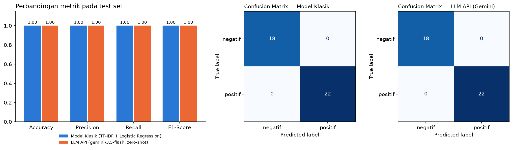

# Eksperimen Model: Analisis Sentimen Ulasan Pelanggan

Di tugas ini saya membandingkan dua cara mengklasifikasikan sentimen ulasan pelanggan e-commerce, positif atau negatif. Cara pertama adalah model machine learning klasik yang saya latih sendiri dengan Scikit-learn. Cara kedua memakai Gemini lewat API, cukup dengan prompt dan tanpa training. Keduanya saya uji di test set yang sama, lalu hasilnya saya bandingkan untuk menentukan mana yang lebih layak dikembangkan.

## Isi repository

- data/customer_reviews_sentiment.csv berisi dataset asli dari assignment. File ini tidak saya ubah sama sekali.
- notebook/experiment_notebook.ipynb berisi seluruh eksperimen, dari pembagian data sampai rekomendasi.
- documentation/model_comparison_summary.png adalah grafik perbandingan yang dibuat otomatis oleh notebook.
- requirements.txt berisi daftar library yang dibutuhkan.

## Problem statement

Tim produk e-commerce ingin punya fitur yang otomatis menandai ulasan pelanggan sebagai positif atau negatif. Dengan begitu tim bisa memantau kepuasan pelanggan dan cepat menanggapi keluhan, tanpa harus membaca ulasan satu per satu. Sebelum memilih pendekatan untuk produksi, tim butuh eksperimen awal sebagai dasar keputusan.

Label yang diprediksi ada di kolom sentiment, dengan dua nilai: positif (pelanggan puas) dan negatif (pelanggan kecewa atau mengeluh). Input yang dipakai hanya kolom review_text.

Batasan dan asumsi yang saya pakai:

- Label di dataset saya anggap benar, dan tidak ada kelas netral.
- Nama produk tidak dipakai sebagai fitur, karena sentimen ditentukan oleh isi ulasannya.
- Kedua pendekatan dinilai dengan test set yang sama (20% data, stratified, random_state=42).
- Gemini dipakai apa adanya, tanpa fine-tuning. API key disimpan di file .env dan tidak ikut di-upload.
- Precision, recall, dan F1-score dihitung dengan macro average, karena kelas positif dan negatif sama pentingnya.

## Dataset

Dataset berisi 200 ulasan berbahasa Indonesia dengan kolom review_id, product_name, review_text, dan sentiment. Ada 110 ulasan positif dan 90 negatif, tanpa data kosong.

Ada satu hal yang baru ketahuan setelah saya periksa. Dari 200 baris itu, hanya ada 40 kalimat yang berbeda (20 positif, 20 negatif). Kalimat yang sama diulang-ulang dengan nama produk yang berbeda. Akibatnya, setelah split acak 80/20, 98% kalimat di test set ternyata juga ada di train set. Ini sangat memengaruhi cara membaca hasil model klasik, dan saya bahas di bagian analisis.

## Eksperimen

Data dibagi menjadi 160 baris train dan 40 baris test (22 positif, 18 negatif). Test set yang sama dipakai untuk kedua pendekatan.

### Pendekatan 1: model klasik

Teks diubah menjadi fitur dengan TF-IDF (semua huruf kecil, unigram dan bigram). Bigram saya pakai supaya frasa seperti "tidak sesuai" terbaca sebagai satu kesatuan. Modelnya Logistic Regression, dilatih dengan data train lalu dipakai memprediksi 40 ulasan test.

### Pendekatan 2: Gemini API

Saya memakai prompt zero-shot. Model hanya diberi instruksi dan dua label yang boleh dipakai, tanpa contoh. Untuk tugas dengan dua label yang jelas seperti ini, contoh tidak terlalu diperlukan, dan prompt jadi lebih pendek.

Kuota free tier Gemini ternyata cepat habis, jadi pemanggilan API saya buat lebih hemat. Tiga ulasan dikirim sekaligus dalam satu request, dan kalimat yang sama hanya dikirim sekali. Hasilnya, 26 kalimat unik di test set cukup diproses dengan 9 request. Jawaban model kemudian dinormalisasi (dijadikan huruf kecil, "positive" diubah jadi "positif", dan seterusnya). Kalau jumlah label di jawaban tidak sama dengan jumlah ulasan yang dikirim, batch itu dikirim ulang satu per satu supaya urutannya tidak tertukar.

Bentuk prompt-nya seperti ini:

> Tentukan sentimen tiap ulasan: "positif" atau "negatif".
> Jawab 3 baris dengan format: nomor. label
>
> 1. (ulasan pertama)
> 2. (ulasan kedua)
> 3. (ulasan ketiga)

Parameter yang saya pakai:

| Parameter          | Nilai            | Alasan                                                                                                       |
| ------------------ | ---------------- | ------------------------------------------------------------------------------------------------------------ |
| Model              | gemini-3.5-flash | Versi Flash cepat dan murah, cukup untuk teks pendek                                                         |
| Temperature        | 0.2              | Klasifikasi butuh jawaban yang konsisten, bukan kreatif                                                      |
| Thinking level     | minimal          | Tugas ini tidak butuh penalaran panjang, dan token untuk "berpikir" ikut dihitung biaya                      |
| Ulasan per request | 3                | Mengurangi jumlah request agar tidak kena rate limit, tapi batch tetap kecil supaya model tidak salah urutan |

## Hasil evaluasi

Keduanya dievaluasi pada 40 ulasan test yang sama.

| Pendekatan                                  | Accuracy | Precision | Recall | F1-score | Training                   | Waktu prediksi                                          |
| ------------------------------------------- | -------- | --------- | ------ | -------- | -------------------------- | ------------------------------------------------------- |
| Model klasik (TF-IDF + Logistic Regression) | 1.00     | 1.00      | 1.00   | 1.00     | Perlu, sekitar 0.004 detik | Sekitar 0.001 detik untuk 40 ulasan                     |
| Gemini API (gemini-3.5-flash, zero-shot)    | 1.00     | 1.00      | 1.00   | 1.00     | Tidak perlu                | Beberapa detik per request, ditambah jeda antar request |

Confusion matrix kedua pendekatan ternyata sama persis (baris = label asli, kolom = prediksi):

|              | Prediksi negatif | Prediksi positif |
| ------------ | ---------------- | ---------------- |
| Asli negatif | 18               | 0                |
| Asli positif | 0                | 22               |

Accuracy 1.00 artinya semua 40 ulasan diprediksi benar. Precision 1.00 berarti tidak ada ulasan yang salah dicap positif atau negatif, dan recall 1.00 berarti tidak ada ulasan yang terlewat. F1-score menggabungkan keduanya, jadi otomatis juga 1.00. Di confusion matrix, semua prediksi ada di diagonal: 18 ulasan negatif dan 22 ulasan positif benar semua.

Dua-duanya sempurna, dan justru itu yang membuat saya curiga. Model klasik lalu saya uji ulang dengan StratifiedGroupKFold 5-fold, supaya kalimat di data test tidak pernah muncul di data train.

| Cara pengujian                                                | Accuracy model klasik                                   |
| ------------------------------------------------------------- | ------------------------------------------------------- |
| Split acak (test set utama, 98% kalimatnya juga ada di train) | 1.00                                                    |
| Kalimat yang belum pernah dilihat (5-fold)                    | Rata-rata 0.44 (per fold: 0.51, 0.39, 0.31, 0.46, 0.55) |

Begitu kalimatnya benar-benar baru, akurasi model klasik turun ke sekitar 0.44, dan 20 dari 40 kalimat unik salah diprediksi. Jadi skor 1.00 tadi lebih karena model hafal kalimatnya, bukan karena paham sentimennya.

## Trade-off dan keterbatasan

Dari sisi metrik di test set utama, hasilnya seri. Tapi model klasik gagal di kalimat baru, sedangkan Gemini tidak pernah melihat data ini sebelumnya. Karena itu menurut saya Gemini yang sebenarnya lebih unggul dari sisi performa.

| Aspek               | Model klasik                                                                                                                     | Gemini API                                                                                                                                       |
| ------------------- | -------------------------------------------------------------------------------------------------------------------------------- | ------------------------------------------------------------------------------------------------------------------------------------------------ |
| Effort implementasi | Butuh data berlabel yang banyak dan beragam, lalu training. Training-nya cepat, yang berat justru mengumpulkan dan melabeli data | Tidak perlu training atau data berlabel. Pekerjaannya pindah ke menyusun prompt, merapikan output, menyimpan API key, dan menangani rate limit   |
| Kecepatan           | Sangat cepat, hitungan milidetik, jalan di laptop sendiri                                                                        | Lebih lambat, beberapa detik per request karena lewat internet, belum termasuk jeda supaya tidak kena limit                                      |
| Biaya               | Hampir gratis, tidak ada biaya per prediksi                                                                                      | Bayar per token kalau pakai paid tier. Free tier-nya terbatas, dan selama eksperimen saya beberapa kali kena error 429 karena kuota harian habis |
| Kontrol data        | Model dan data sepenuhnya di tangan sendiri                                                                                      | Ulasan pelanggan dikirim ke server pihak ketiga, dan kita bergantung pada layanan serta versi model mereka                                       |

Keterbatasan model klasik paling terlihat dari kesalahannya pada kalimat baru. Beberapa contohnya:

- "Produk palsu, bukan barang original seperti yang dijanjikan." diprediksi positif. Kata "original" di data train hanya muncul di ulasan positif.
- "Bahan nyaman dipakai, ukuran pas, tidak mengecewakan." diprediksi negatif, karena kata "tidak" lebih sering muncul di ulasan negatif.
- "Produknya rapi dan bersih, tidak ada cacat sama sekali." juga diprediksi negatif, gara-gara kata "tidak" dan "cacat".

TF-IDF hanya menghitung kata, bukan memahami kalimat. Negasi, sarkasme, dan ulasan yang isinya campur aduk jadi mudah salah. Kata yang tidak ada di data train, seperti slang atau singkatan, juga diabaikan begitu saja, sehingga model perlu dilatih ulang setiap kali muncul pola bahasa baru.

Gemini juga punya keterbatasan:

- Bergantung pada layanan luar. Kuota harian sempat menghentikan eksperimen saya beberapa kali, dan model gemini-2.0-flash yang ada di starter notebook sudah tidak bisa dipakai.
- Jawabannya berupa teks bebas, jadi harus diparsing dan dinormalisasi. Dengan batching, ada risiko jumlah atau urutan label tidak cocok. Risiko ini saya tangani dengan mengecek jumlah label dan mengirim ulang per ulasan kalau perlu.
- Hasilnya tidak selalu sama persis antar run, walaupun temperature sudah dibuat rendah.
- Waktu dan biaya ikut naik seiring jumlah ulasan.
- Test set-nya kecil (26 kalimat unik) dan bahasanya rapi. Saya belum tahu seberapa bagus hasilnya untuk ulasan asli yang penuh singkatan atau sarkasme.

## Rekomendasi

Saya merekomendasikan Gemini API untuk dikembangkan lebih lanjut, dengan beberapa penyesuaian supaya biayanya terkendali.

Alasan utamanya ada di uji tambahan tadi. Skor 1.00 model klasik ternyata hasil hafalan, karena 98% kalimat test sudah ada di train. Begitu diuji dengan kalimat baru, akurasinya tinggal sekitar 0.44, bahkan salah pada kalimat yang sangat jelas bagi manusia. Dengan hanya 40 kalimat unik untuk belajar, model klasik memang belum bisa diandalkan.

Gemini tidak pernah dilatih dengan dataset ini, jadi skornya murni dari kemampuannya memahami bahasa Indonesia, termasuk negasi seperti "tidak mengecewakan". Ulasan di halaman produk selalu baru dan beragam, jadi kemampuan menangani kalimat yang belum pernah dilihat adalah hal yang paling penting di sini. Selain itu, Gemini bisa langsung dipakai tanpa harus mengumpulkan dan melabeli data dulu, sehingga fiturnya bisa dirilis lebih cepat.

Supaya kelemahannya tidak jadi masalah di produksi:

- Pakai paid tier, dan tetap kirim beberapa ulasan per request, atur thinking level ke minimal, serta simpan hasil untuk ulasan yang sama supaya tidak dikirim ulang.
- Jalankan klasifikasi di belakang layar, misalnya lewat antrean setiap ada ulasan baru, bukan saat halaman produk dibuka.
- Buat nama model mudah diganti, validasi setiap jawaban, dan cek sampel hasilnya secara berkala oleh manusia.

Untuk tahap berikutnya, saya akan mengumpulkan ulasan asli yang lebih banyak dan beragam, lalu menguji ulang Gemini dengan data itu. Gemini juga bisa dipakai untuk membantu melabeli ulasan baru, tentu dengan pengecekan manusia, sampai terkumpul dataset yang cukup besar. Setelah datanya cukup, model klasik bisa dilatih ulang dan dipakai bersama Gemini. Ulasan yang sudah jelas ditangani model klasik yang gratis dan cepat, sedangkan ulasan yang ambigu baru dikirim ke Gemini. Dengan cara ini biaya API bisa ditekan tanpa mengorbankan akurasi.

## Cara menjalankan

1. Clone repository ini, lalu siapkan virtual environment:
   - git clone https://github.com/RamaRezky/model-experiment-assignment-Rama-Maulana-Rezky.git
   - cd model-experiment-assignment-Rama-Maulana-Rezky
   - python -m venv venv
   - source venv/Scripts/activate (Git Bash di Windows), venv\Scripts\activate (Command Prompt), atau source venv/bin/activate (macOS/Linux)
   - pip install -r requirements.txt
2. Buat API key di [Google AI Studio](https://aistudio.google.com/apikey). Setelah itu buat file bernama .env di folder utama project (sejajar dengan README ini), isinya satu baris: GEMINI_API_KEY=isi_api_key_anda.
3. Buka notebook/experiment_notebook.ipynb di VS Code atau Jupyter, pilih kernel dari virtual environment tadi, lalu klik Run All. Bagian Gemini hanya butuh sekitar 9 request, kira-kira 1 sampai 2 menit. Grafik perbandingan otomatis tersimpan di folder documentation.

Kalau muncul error 429 RESOURCE_EXHAUSTED, berarti kuota free tier sedang habis. Tunggu sampai kuotanya reset, atau ganti nama model di cell 5.2.
